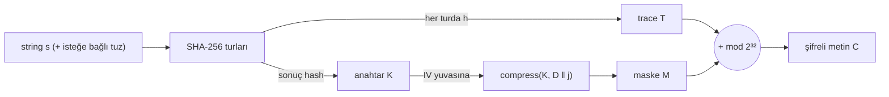

# SHA-256'nın İçinden Geçen Yol

### Tek bir register'dan mesajı geri kurmak ve sonuç hash'i anahtar yapan bir şifreleme

> **Uyarı:** Bu depo eğitim ve araştırma amaçlıdır. Kod bağımsız bir güvenlik denetiminden geçmemiştir ve saf Python olduğu için yavaştır. Gerçek verileri korumak için kullanmayın.

SHA-256 çoğu zaman bir kara kutu gibi düşünülür: içine bir metin girer, 256 bitlik bir özet çıkar ve geri dönüş yoktur. Oysa kutunun içi şaşırtıcı derecede düzenlidir. Bu yazıda, sıkıştırma fonksiyonunun içindeki sekiz çalışma register'ını (`a`…`h`) yakından inceliyor ve üç soruyu yanıtlıyoruz:

1. Her turda register'lardan **sadece birinin** değerini ve sonuç hash'i bilirsek, mesajı baştan kurabilir miyiz? **Evet**, sekizinden herhangi biriyle.
2. Bu "tur izi" (trace) bir şifreli metin olarak kullanılabilir mi? **Hayır**, anahtar olmadan da çözülüyor.
3. Kurallara sadık kalarak (anahtar = SHA-256 sonuç hash'i, şifreli metin = mesajın SHA-256'dan geçerkenki izi, SHA-256 dışında kriptografik bileşen yok) çalışan bir şifreleme kurulabilir mi? **Evet**, SHA-256'nın iç yapısındaki doğru noktayı kullanarak.

Tüm kriptografi [`sha256_core.py`](sha256_core.py) içinde sıfırdan yazılmış SHA-256 üzerinde çalışır. Python'un `hashlib` / `hmac` modülleri yalnızca **testlerde**, kendi uygulamamızın doğruluğunu karşılaştırmak için kullanılır.

---

## 1. SHA-256'ya kısa bir bakış

Mesaj önce dolgulanır (padding: `0x80` baytı, sıfırlar ve 64 bitlik uzunluk) ve 512 bitlik bloklara bölünür. Her blok 16 adet 32 bitlik kelimeye (`W[0..15]`) ayrılır ve **mesaj genişletme** (message schedule) ile 64 kelimeye uzatılır:

```
W[t] = σ1(W[t-2]) + W[t-7] + σ0(W[t-15]) + W[t-16]      (t = 16..63, mod 2³²)
```

Sıkıştırma fonksiyonu sekiz register'lık bir durumla başlar. İlk blokta bu durum standart IV'dir, sonraki bloklarda bir önceki bloğun çıktısıdır. 64 tur boyunca her turda şu hesaplanır:

```
T1 = h + Σ1(e) + Ch(e,f,g) + K[t] + W[t]
T2 = Σ0(a) + Maj(a,b,c)

a ← T1 + T2      b ← a      c ← b      d ← c
e ← d + T1       f ← e      g ← f      h ← g
```

64 turun sonunda **feed-forward** uygulanır: `H_yeni = H_eski + durum` (kelime kelime, mod 2³²). Son bloğun `H` değeri, sonuç hash'tir.

## 2. Kritik gözlem: aslında sadece iki register var

Tur denklemlerine dikkatle bakınca, her turda yalnızca **iki** register'ın yeni hesaplandığı görülür: `a` ve `e`. Geri kalan altısı sadece kaydırmadır. Dolayısıyla her register, `a` ya da `e` dizisinin gecikmeli bir kopyasıdır:

| Register | Eşittir | Gecikme |
|---|---|---|
| `a` | `a_t` | 0 |
| `b` | `a_{t-1}` | 1 |
| `c` | `a_{t-2}` | 2 |
| `d` | `a_{t-3}` | 3 |
| `e` | `e_t` | 0 |
| `f` | `e_{t-1}` | 1 |
| `g` | `e_{t-2}` | 2 |
| `h` | `e_{t-3}` | 3 |

Şimdi durumu IV'den başlayarak ileriye doğru takip ettiğimizi varsayalım. `t` turundaki durumun tamamı biliniyorsa, `T1`'in `W[t]` dışındaki bütün terimleri bilinir. Sıradaki `a` (ya da `e`) değeri bilindiği anda `W[t]` **mod 2³² toplama ile tek şekilde** belirlenir:

```
a ailesi:  T1 = a_{t+1} − T2(a_t, b_t, c_t)
e ailesi:  T1 = e_{t+1} − d_t
sonra:     W[t] = T1 − (h_t + Σ1(e_t) + Ch(e_t, f_t, g_t) + K[t])
```

`W[t]` bulununca tur normal şekilde ilerletilir ve durum yine tamamen bilinir. Bu tümevarımla 64 turun hepsi çözülür. **`W[0..15]` mesaj bloğunun ta kendisidir.** `W[16..63]` ise mesaj genişletme formülüyle tutmak zorundadır. Bu da ücretsiz bir tutarlılık kontrolü sağlar.

### Gecikmeli register'lar ve sonuç hash'in rolü

`a` ya da `e` sızdırılırsa sonuç hash'e hiç gerek kalmaz. Gecikmeli register'larda (`b, c, d, f, g, h`) ise bloğun son 1–3 değeri trace'te yoktur. Örneğin `h` için `e_62, e_63, e_64` eksiktir. Bunlar feed-forward eşitliğinden gelir:

```
durum_64 = (a64, a63, a62, a61, e64, e63, e62, e61)
H_i = H_{i−1} + durum_64   ⇒   e_{64−m} = H_i[4+m] − H_{i−1}[4+m]
```

Son blokta `H_i` sonuç hash'tir. Ara bloklarda ise `H_i` bir sonraki bloğun IV'sidir ve bu değerler sonraki bloğun ilk 1–3 trace değerinde zaten görünür. Böylece çok bloklu mesajlar da eksiksiz çözülür.

**Uygulama:** [`encoder.py`](encoder.py) mesajı hash'ler ve seçilen register'ın her turdaki değerini JSON'a yazar. [`decoder.py`](decoder.py) bu trace'ten ve sonuç hash'ten mesajı kurar ve hash'i yeniden hesaplayarak doğrular. [`test_roundtrip.py`](test_roundtrip.py) sekiz register'ın hepsini, blok sınırlarındaki uzunluklar dahil (55, 56, 64, 65, 120 bayt…) 0–1000 baytlık mesajlarla dener. Hepsi `hashlib` ile birebir aynı sonucu verir.

## 3. Trace neden bir şifreli metin değildir?

Akla ilk gelen fikir, trace'i şifreli metin, sonuç hash'i de anahtar olarak kullanmaktır. Ama yukarıdaki türetmeye bakınca sorun hemen görülür: sonuç hash yalnızca son bloğun **son 1–3 turunda**, yani `W[61..63]`'te kullanılır. Bunlar mesaj kelimesi değildir. Mesaj kelimeleri `W[0..15]` ise herkesin bildiği IV'den ileri doğru, sadece trace ile bulunur.

[`attack_no_key.py`](attack_no_key.py) sonuç hash yerine sıfır koyar ve mesajı yine eksiksiz çıkarır. [`test_attack.py`](test_attack.py) bunun sekiz register'ın hepsinde işe yaradığını gösterir.

IV'yi gizli bir anahtar yapmak da yetmez. `h` trace'i ilk üç turda IV'nin `e` yarısını açıkça verir. Tek bir düz metni bilen saldırgan ise `d_t = e_{t+1} − T1` eşitliğinden `a` yarısını tur tur geri çıkarır.

Ana ders şu: **Trace bir şifreleme değil, bir kodlamadır.** Hesapta gizli hiçbir şey yoktur.

Bu gözlem kriptografide yeni değildir. SHA-2 tur fonksiyonunun tersinirliği ve durumun `A_i`/`E_i` dizileriyle ifadesi kriptanalizde standarttır (bkz. Mendel–Nad–Schläffer). Sızan ara değerlerden `W[t]`'ye ulaşmak da HMAC-SHA-2'ye yönelik güç analizi (DPA) saldırılarının temel adımıdır (bkz. McEvoy ve diğ.; Belaïd ve diğ.).

## 4. Rolleri tersine çevirmek: SHA-256'nın içindeki blok şifre

Trace şemasında `W` gizlenmek istenen şeydi, durum ise herkese açıktı. Roller tersine çevrilirse ne olur?

Feed-forward kaldırıldığında sıkıştırma fonksiyonu 256 bitlik bir **blok şifreye** dönüşür. Bu şifrenin adı **SHACAL-2**'dir (Handschuh & Naccache). NESSIE projesi 2003'te SHACAL-2'yi önerilen algoritmalar arasına seçmiştir.

- **Anahtar:** 512 bit, `W[0..15]`. Mesaj genişletme bu anahtardan 64 tur anahtarı üretir.
- **Düz metin:** başlangıç durumu `a..h` (32 bayt).
- **Şifreli metin:** 64 tur sonrasındaki `a..h`.

Çözme, turları geriye doğru çalıştırmaktır. Bu, decoder'daki tersine çevirmenin aynısıdır:

```
a = b'   b = c'   c = d'   e = f'   f = g'   g = h'
T2 = Σ0(a) + Maj(a,b,c)
T1 = a' − T2
d  = e' − T1
h  = T1 − Σ1(e) − Ch(e,f,g) − K[t] − W[t]
```

[`sha256_cipher.py`](sha256_cipher.py) bu fikri CBC modu ve kendi HMAC-SHA256'mızla (encrypt-then-MAC) birleştirir. Anahtar, bir kez üretilen rastgele bir dosyadır. [`test_sha256_cipher.py`](test_sha256_cipher.py) şunları doğrular:
- `SHACAL-2(H) + H`, SHA-256 sıkıştırmasıyla birebir aynıdır.
- Ters turlar şifrelemeyi tam olarak geri alır.
- Düz metinde tek bir bitin değişmesi, şifreli blokta ortalama **~128 / 256** bit değiştirir (ideal çığ etkisi).

## 5. Sonuç hash'i anahtar yapmak: mesaja kilitli şifreleme

Asıl hedefimiz daha katı kurallara sahipti:

- **Anahtar** = string'in SHA-256 sonuç hash'i
- **Şifreli metin** = string SHA-256'dan geçerken her turda bir register'ın değeri
- SHA-256 dışında hiçbir kriptografik bileşen yok

### Anahtar SHA-256'nın içinde nereye girebilir?

Bölüm 3'te gördüğümüz gibi, SHA-256'da her şey IV'den ileri doğru hesaplanır. Gizli bir değerin bu yapıya girebileceği tek yer **zincir değeridir**, yani IV'nin durduğu yuvadır.

İşte kilit gözlem: **sonuç hash zaten bir zincir değeridir.** Mesaj devam etseydi, bir sonraki bloğun IV'si olacaktı. Dolayısıyla anahtarı tam o yuvaya koyabiliriz:

```
maske_j = compress(K, D ‖ j)        K: sonuç hash (IV yerine), D: alan etiketi, j: sayaç
C_t     = T_t + M_t   (mod 2³²)     T: trace, M: maske kelimeleri
```

Burada `compress`, feed-forward dahil SHA-256'nın kendi sıkıştırma fonksiyonudur. Maskeyle örtme işlemi de yine SHA-256'nın kendi işlemi olan mod 2³² toplamadır.



**Çözme:** `K` ile maske yeniden üretilir ve `T = C − M` hesaplanır. Ortaya çıkan çıplak trace, Bölüm 2'deki decoder ile tur tur çözülür.

**Doğrulama kendiliğinden gelir.** Çözülen string'in SHA-256'sı `K`'ya eşit olmak zorundadır. Ayrıca çözülen string yeniden trace'lenir ve şifreli metnin tamamıyla karşılaştırılır. Şifreli metni değiştiren biri, aynı hash'i veren başka bir string bulmak, yani bir SHA-256 çarpışması üretmek zorunda kalır.

Uygulama [`sha256_mle.py`](sha256_mle.py) dosyasındadır. [`test_sha256_mle.py`](test_sha256_mle.py) şunları gösterir:
- 8 register'ın hepsinde, tuzlu ve tuzsuz olarak gidiş-dönüş çalışır.
- Anahtar gerçekten `SHA-256(mesaj)` değeridir (`hashlib` ile karşılaştırılarak).
- Bölüm 3'teki anahtarsız saldırı artık **başarısız** olur.
- Şifreli metnin **her baytında** tek bir bitin değiştirilmesi reddedilir. Yanlış anahtar da reddedilir.

### Güvenlik gerekçesi

Saldırgan `K`'yı bilmediği sürece maske rastgele görünür. Bunun dayandığı varsayım şudur: zincir değeri gizliyken sıkıştırma fonksiyonu sözde-rastgele bir fonksiyondur (PRF). Bu, NMAC/HMAC'in güvenlik ispatlarının da dayandığı temel varsayımdır (Bellare, 2006).

Bir incelik var: düz metin (ve son trace değerleri) anahtara bağlıdır. Bu, bir "anahtara bağlı mesaj" durumudur. Bu sınıftaki şemaların titiz analizi, literatürde olduğu gibi rastgele kâhin (random oracle) modelinde yapılır.

### Bu sınıfın kaçınılmaz sınırları

"Anahtar = mesajın hash'i" kuralı, literatürde **convergent encryption** (Douceur ve diğ., 2002) ya da **message-locked encryption** (Bellare–Keelveedhi–Ristenpart, 2013) olarak bilinir. Kuraldan doğan sınırlar şunlardır:

1. **Tahmin edilebilir mesajlar denemeyle çözülür.** "evet", bir PIN ya da bir tarih gibi mesajlarda saldırgan tahmininin SHA-256'sını anahtar olarak dener.
   - `--tuz` seçeneği string'in sonuna 16 rastgele bayt ekler. Anahtar yine SHA-256'ya atılan o string'in sonuç hash'idir, yani kural korunur.
   - Testte tuzsuz "evet" denemeyle çözülür, tuzlu "evet" çözülemez.
   - Rastgele baytlar işletim sisteminden (`os.urandom`) gelir. SHA-256 deterministik olduğu için rastgeleliği kendisi üretemez.
2. **Anahtar her mesajda değişir.** Her mesajın anahtarı alıcıya ayrıca ve gizlice iletilmelidir.
3. **Tuzsuz şifreleme deterministiktir.** Aynı mesaj her zaman aynı şifreli metni verir, bu da iki mesajın aynı olduğunu ele verir.
4. **Uzunluk ve boyut:** Mesaj uzunluğu 64 bayt hassasiyetinde görünür. Şifreli metin mesajın yaklaşık 4 katı büyüklüktedir (64 baytlık blok başına 64 × 4 bayt).

---

## Kullanım

Python 3 yeterlidir, ek paket gerekmez. Windows'ta `python` yerine `py` yazın.

```bash
# 1) Tek register'dan mesajı geri kurma
python encoder.py "Merhaba dünya" -r h -o trace.json
python decoder.py trace.json
python attack_no_key.py trace.json          # çıplak trace anahtarsız çözülür

# 2) Mesaja kilitli şifreleme (anahtar = SHA-256 sonuç hash)
python sha256_mle.py enc "Gizli mesaj" -o mesaj.mle --key-out mesaj.key
python sha256_mle.py enc "evet" --tuz -o mesaj.mle --key-out mesaj.key
python sha256_mle.py dec mesaj.mle -k mesaj.key

# 3) SHACAL-2 (SHA-256'nın içindeki blok şifre)
python sha256_cipher.py keygen -o anahtar.key
python sha256_cipher.py enc "Gizli mesaj" -k anahtar.key -o mesaj.s2c
python sha256_cipher.py dec mesaj.s2c -k anahtar.key
```

Testler:

```bash
python test_roundtrip.py && python test_attack.py && python test_sha256_cipher.py && python test_sha256_mle.py
```

## Dosyalar

| Dosya | İçerik |
|---|---|
| `sha256_core.py` | Sıfırdan SHA-256: tur fonksiyonu, ters tur, mesaj genişletme, trace kaydı |
| `encoder.py` / `decoder.py` | Tek register trace'i üretme / trace + hash'ten mesajı kurma |
| `attack_no_key.py` | Çıplak trace'in anahtarsız çözülebildiğinin gösterimi |
| `sha256_cipher.py` | SHACAL-2 + CBC + HMAC-SHA256 (rastgele anahtar dosyasıyla) |
| `sha256_mle.py` | Anahtar = sonuç hash, şifreli metin = maskelenmiş trace |
| `test_*.py` | Her bölüm için doğrulama testleri |

## Kaynaklar

- NIST, *FIPS 180-4: Secure Hash Standard*, 2015.
- H. Handschuh, D. Naccache, *SHACAL*, NESSIE başvurusu, 2000–2001.
- R. McEvoy, M. Tunstall, C. C. Murphy, W. P. Marnane, *Differential Power Analysis of HMAC Based on SHA-2, and Countermeasures*, WISA 2007.
- S. Belaïd, L. Bettale, E. Dottax, L. Genelle, F. Rondepierre, *Differential Power Analysis of HMAC SHA-2 in the Hamming Weight Model*, SECRYPT 2013.
- F. Mendel, T. Nad, M. Schläffer, *Improving Local Collisions: New Attacks on Reduced SHA-256*, EUROCRYPT 2013.
- M. Bellare, *New Proofs for NMAC and HMAC: Security without Collision-Resistance*, CRYPTO 2006.
- J. R. Douceur, A. Adya, W. J. Bolosky, D. Simon, M. Theimer, *Reclaiming Space from Duplicate Files in a Serverless Distributed File System*, ICDCS 2002.
- M. Bellare, S. Keelveedhi, T. Ristenpart, *Message-Locked Encryption and Secure Deduplication*, EUROCRYPT 2013.
